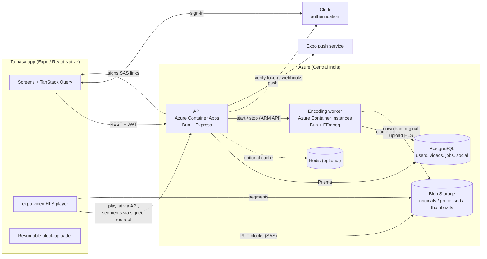
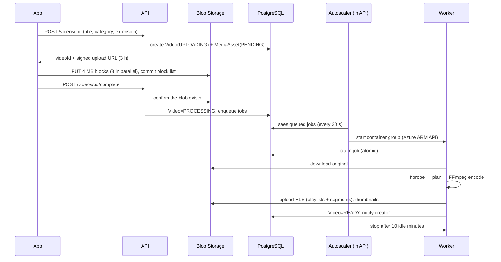

# Tamasa — Video Showcase & On-Demand Streaming Platform

Tamasa is a mobile-first video-on-demand platform. Creators upload videos, the backend encodes them into adaptive
streams, and viewers watch long videos and Shorts, follow creators, comment, save, download and get notified, all from
one Android/iOS app. It is built end to end: an Expo/React Native app, a Bun + Express API, a background video-encoding
worker, PostgreSQL, Azure Blob Storage and Azure container hosting.

> **Repository:** `VIDEO_SHOWCASE_PLATFORM` · **App name:** Tamasa · **Android package:** `com.toufik.tamasa`

---

## Table of contents

1. [Project goal](#1-project-goal)
2. [App features](#2-app-features)
3. [Repository structure](#3-repository-structure)
4. [Tech stack and tools](#4-tech-stack-and-tools)
5. [Architecture](#5-architecture)
6. [How the backend works](#6-how-the-backend-works)
7. [How video encoding works](#7-how-video-encoding-works)
8. [System design deep dives](#8-system-design-deep-dives)
9. [Data model](#9-data-model)
10. [Deployment and operations](#10-deployment-and-operations)
11. [Security](#11-security)
12. [Complexity analysis (time and space)](#12-complexity-analysis-time-and-space)
13. [Limitations](#13-limitations)
14. [Challenges we hit and how we solved them](#14-challenges-we-hit-and-how-we-solved-them)
15. [Future plans](#15-future-plans)
16. [Running it locally](#16-running-it-locally)
17. [Testing](#17-testing)
18. [Related documents](#18-related-documents)
---

## 1. Project goal

Build a complete, realistic video platform that a small community (the design target is a college of about 500 users)
can actually use, while learning and demonstrating the engineering behind platforms like YouTube:

- **For creators:** upload a file from the phone, even a large one, and have it become a watchable, adaptive-quality
  video without any manual work; manage it, publish it with the right visibility, and see how it performs.
- **For viewers:** fast start, smooth playback that adapts to the connection, subtitles and multiple audio languages,
  Shorts, search, social features and offline downloads.
- **For the operator:** a system that is cheap to run (the expensive encoder only runs while there is work), safe
  (private videos stay private, deleted data is really gone) and observable.

Design principles that run through the whole project:

1. **The database is the source of truth.** Caches, filters and in-memory structures are optimisations that can be
   missing or stale without breaking correctness.
2. **Video bytes never pass through the API.** Uploads go straight to storage; playback segments are served from
   storage with short-lived signed links.
3. **Heavy work is asynchronous.** Encoding happens in a separate worker fed by a database-backed queue.
4. **Pay only for what runs.** The encoding worker starts when there are jobs and stops when it has been idle.
5. **Deleting means deleting.** No soft-delete graveyards: a deleted video is removed from the database and storage.

---

## 2. App features

### Viewing
- Home feed with category chips, trending section and cursor-paginated infinite scrolling.
- **Shorts**: a vertical, swipe-through feed of short-form videos.
- Search across videos, creators and topics (categories), with debounced input.
- **Adaptive HLS player**: Auto quality follows the connection; manual quality selection; "Data saver"; playback speed;
  resume from where you stopped; screen-keep-awake; orientation handling.
- **Subtitles**: selectable text-subtitle tracks (converted to WebVTT), drawn by our own overlay, with a subtitle
  **delay control** in 0.1 s steps remembered per video.
- **Multiple audio languages**: for files with dual/multi audio, an Audio entry appears in the player settings.
- Related videos, watch history, watch-later, saved videos, liked videos.
- **Offline downloads** of videos with a Downloads tab and an offline player.
- Deep links (`https://www.toufiktamasa.tech/video/...`) open straight into a video.

### Social
- Like, comment, reply (threaded), like comments, share, save.
- Follow / unfollow creators; followers and following lists.
- Notifications (new follower, new video from someone you follow, reply to your comment, like, comment) with push
  notifications to the device and an in-app notification list.

### Creators
- "Become a creator" flow with a channel (name, about text, avatar, banner).
- **Resumable upload** of large videos straight to storage, with automatic thumbnail or a custom one.
- Content manager: edit title/description/thumbnail, publish with visibility (Public / Unlisted / Private), delete.
- **Creator Studio**: overview (views, followers, likes, comments, shares, videos, views-over-time chart, top videos),
  per-video analytics, and a comment moderation list.
- Live processing status: the video becomes watchable at 480p/720p first, and HD renditions appear later.

### Account
- Sign-in / sign-up with email or social providers, password reset (Clerk).
- Live username availability check, permanent usernames, editable display name, bio and avatar.
- Settings, account deletion (removes the person's data and creator videos), over-the-air app updates with an in-app
  update banner.

---

## 3. Repository structure

```
VIDEO_ON_DEMAND _APP/
├── README.md                     ← this file
├── API_DOCUMENTATION.md          ← full REST contract (endpoints, payloads, errors)
├── LICENSE
├── backend/                      ← Bun + Express API and the encoding worker (one image, two commands)
│   ├── Dockerfile                ← same image runs the API ("bun run start") or the worker ("bun run worker")
│   ├── prisma/                   ← schema.prisma + SQL migrations
│   ├── scripts/                  ← seed categories, Azure/DB smoke tests, encode benchmark
│   ├── docs/                     ← scalability audit and baseline notes
│   └── src/
│       ├── server.ts             ← process entry: listen, start autoscaler, purge job, username filter
│       ├── app.ts                ← Express app: middleware order, routers, error handling
│       ├── config/               ← env validation, Prisma client, Azure clients, Clerk, FFmpeg paths
│       ├── middleware/           ← auth, rate limiting, token bucket, request log, errors, 404
│       ├── routes/               ← HTTP layer (validation with zod) — thin, calls services
│       │   └── video, playback, feed, shorts, social, library, studio, creator, profile, me,
│       │       notification, devices, category, webhook
│       ├── services/             ← business logic
│       │   ├── video.service / video-delete.service / purge.service
│       │   ├── media-processing.service / audio.service / subtitle.service / job.service
│       │   ├── playback.service / feed.service / social.service / library.service / studio.service
│       │   ├── user.service / profile.service / creator.service / viewer.service
│       │   ├── notification.service / push.service / device.service
│       │   ├── azure-storage.service / worker-autoscale.service / username-filter.service
│       ├── workers/
│       │   └── video-processor.worker.ts   ← the queue consumer (FFmpeg orchestration)
│       ├── lib/                  ← pure, unit-tested helpers
│       │   └── ladder, audioTracks, languages, jobContext, mediaPaths, purgeTargets,
│       │       bloomFilter, playbackTicket, videoClassification, videoWhere, videoCard, signImage
│       ├── cache/                ← optional Redis cache-aside layer (falls back to PostgreSQL)
│       └── rate-limit/           ← token-bucket limiter
└── frontend/vidoe_on_demand/     ← the Expo / React Native app ("Tamasa")
    ├── app.json, eas.json        ← app config, EAS build + OTA update channel
    └── src/
        ├── app/                  ← expo-router file-based routes
        │   ├── (tabs)/           ← Home, Shorts, Create (+), Downloads, Profile
        │   ├── (public)/         ← video, creator, category, search, trending, offline player
        │   ├── (auth)/           ← sign-in, sign-up, forgot-password
        │   ├── (app)/            ← dashboard, notifications, followers, following, settings, edit-profile, become-creator
        │   └── (creator)/        ← studio, content, upload, analytics, comments
        ├── api/                  ← typed API client + one module per backend area
        ├── hooks/                ← TanStack Query hooks (queries/) and mutations (mutations/)
        ├── features/             ← screen-level feature components (upload, studio, shorts, video, …)
        ├── components/           ← design-system UI, video player, navigation (glass dock), brand
        ├── css/                  ← design tokens: colours, type, spacing, radii, glass, motion
        ├── lib/                  ← auth, downloads, upload (resumable), subtitles, push, query client, config
        └── types/, utils/
```

---

## 4. Tech stack and tools

### Frontend (mobile app)
| Area | Choice |
|---|---|
| Framework | **React Native 0.86** with **Expo SDK 57**, React 19, TypeScript |
| Routing | **expo-router** (file-based), React Navigation under the hood |
| Server state | **TanStack Query v5** (caching, infinite queries, invalidation, focus/online managers) |
| Video | **expo-video** (HLS, audio/subtitle/quality track APIs) |
| Auth | **Clerk** (`@clerk/clerk-expo`), tokens in `expo-secure-store` |
| Files | `expo-file-system` (resumable block upload, downloads), `expo-image-picker` |
| UI | custom design tokens, `expo-glass-effect` / `expo-blur`, Reanimated 4, Gesture Handler, `expo-image` |
| Push | `expo-notifications` |
| Updates | **EAS Update** (over-the-air JS updates), **EAS Build** (APK) |
| Other | NetInfo (online state), AsyncStorage (small preferences, upload resume state) |

### Backend
| Area | Choice |
|---|---|
| Runtime | **Bun** (TypeScript, built-in test runner) |
| HTTP | **Express 5**, `helmet`, `cors`, `express-rate-limit` |
| Validation | **zod** |
| Database | **PostgreSQL** (Azure Database for PostgreSQL Flexible Server) via **Prisma 7** with the `pg` driver adapter |
| Object storage | **Azure Blob Storage** (`@azure/storage-blob`) with SAS (signed) URLs |
| Auth | **Clerk** (`@clerk/express`), Svix-verified webhooks for user lifecycle |
| Video processing | **FFmpeg / ffprobe** (bundled via `ffmpeg-static`, `ffprobe-static`) driven with `fluent-ffmpeg` |
| Cache (optional) | **Redis** via `ioredis` (cache-aside + token bucket); the app runs without it |
| Push | Expo push service |

### Infrastructure and tooling
| Area | Choice |
|---|---|
| API hosting | **Azure Container Apps** (1–2 replicas) |
| Worker hosting | **Azure Container Instances** (4 vCPU / 8 GB), started and stopped on demand |
| Container registry | **Azure Container Registry** (Basic) |
| Packaging | One **Docker** image (`oven/bun`) for both API and worker |
| CI/CD | GitHub Actions (checks + backend deploy + OTA publish), Azure sign-in via OIDC |
| Source control | Git / GitHub |
| Testing | `bun test` (unit tests for pure logic), real-database / real-storage end-to-end scripts during development |

---

## 5. Architecture



**Architectural style:** a modular monolith API (routes → services → Prisma) plus one asynchronous worker, sharing a
single PostgreSQL database and a single blob store. The two processes ship in the same image and differ only in their
start command.

**Layering in the backend**

```
HTTP request
   │  middleware: helmet · cors · request log · rate limiters · JSON body · auth (Clerk JWT)
   ▼
routes/       parse + validate input (zod), choose status codes        ← thin
   ▼
services/     business rules, transactions, authorisation checks       ← the logic
   ▼
Prisma  ·  Azure Blob  ·  Clerk  ·  Redis(optional)
```

**Frontend layering**

```
screens (src/app) → feature components → hooks (TanStack Query) → api/ client → backend
                                      ↘ lib/ (upload, downloads, subtitles, push, auth)
```

---

## 6. How the backend works

### Request pipeline (`src/app.ts`)
1. `helmet`, `cors`, request logger.
2. The Clerk webhook route is mounted **before** JSON parsing (it needs the raw body for signature verification) and has
   a strict rate limiter.
3. `express.json()`, then the general **API rate limiter** (per IP) and a **token-bucket limiter** (per user, with IP
   fallback; it is Redis-backed, so it is a no-op while Redis is not deployed, see [§11.6](#11-security)). Video segment traffic has its own, much higher limiter so playback never exhausts the normal budget.
4. Routers mounted under `/api`; then a 404 handler and a central error handler that maps `ApiError` to the
   `{ success, error }` response envelope.

### Authentication
- The app signs in with **Clerk** and sends the Clerk JWT as `Authorization: Bearer …`.
- `authenticateUser` requires a valid token; `optionalAuth` accepts anonymous visitors (public videos) but recognises
  signed-in viewers to apply visibility rules and viewer state (`isLiked`, `progress`, …).
- A Clerk **webhook** (verified with Svix) creates / updates / deactivates the local `User` + `Profile` rows.

### Main API areas (full contract in [API_DOCUMENTATION.md](API_DOCUMENTATION.md))
| Area | Examples |
|---|---|
| Identity | `GET /api/me`, `PATCH /api/profile`, `GET /api/username-available`, `GET /api/users/:username` |
| Creator | become creator, channel images, `GET /api/creators/:id/videos` |
| Upload workflow | `POST /api/videos/init` → direct upload → `POST /api/videos/:id/complete` → `POST /api/videos/:id/publish` |
| Resume | `POST /api/videos/:id/upload-url` (fresh signed link for an unfinished upload) |
| Discovery | `GET /api/feed`, `/shorts`, `/search`, `/trending`, `/categories`, `/videos/:id/related` |
| Playback | `GET /api/videos/:id/stream/*` (HLS), `GET …/download`, watch start / progress |
| Social | likes, comments, replies, follow, share |
| Library | history, watch later, saved, liked |
| Notifications | list, mark read, device-token registration for push |
| Studio | overview, per-video analytics, comment moderation |

### Playback delivery
- The **master playlist** and rendition playlists are small text files: the API fetches them, rewrites their segment
  URIs and serves them, applying visibility rules.
- **Segments** (the big `.ts` files) are served with a **302 redirect to a short-lived SAS URL** on Blob Storage, so
  video bytes never flow through Express.
- Private/unlisted videos use a **playback ticket**: an HMAC-signed, per-video, expiring token. The player cannot send
  the login header to storage (Azure rejects a request that has both a signed link and an `Authorization` header), so the
  ticket is carried as a `?pt=` query parameter that is added to every URI in the playlists.

### Views, likes, counters
- Likes/saves/follows are protected by database **unique constraints**; counters use atomic `increment`/`decrement`.
- A **view** is an account's **first** watch of a video: the public counter increments only then; replays are recorded
  in the history but are not views. Studio's period figures and chart use the same first-watch rule, so they can never
  exceed the lifetime total.

### Notifications
`NotificationService` writes an in-app notification and fires a **fire-and-forget** push via the Expo push service
(so a slow push never delays an API response). Devices register tokens through `/api/devices`.

### Background jobs inside the API process
- **Worker autoscaler**: starts/stops the encoding worker (see [§10](#10-deployment-and-operations)).
- **Purge job**: a safety-net sweep that removes anything left behind by a crash (see [§8.4](#84-hard-delete)).
- **Username filter**: the in-memory Bloom filter for username checks (see [§8.6](#86-bloom-filter-for-username-availability)).

---

## 7. How video encoding works

### 7.1 From upload to watchable



### 7.2 The job queue
- Jobs live in the `media_processing_jobs` table: `TRANSCODE_STANDARD`, `TRANSCODE_1080P`, `TRANSCODE_1440P`,
  `THUMBNAIL`, `PREVIEW`, with statuses `QUEUED → RUNNING → SUCCEEDED | FAILED | RETRYING`.
- **Claiming is race-safe**: `UPDATE … WHERE status = 'QUEUED'` (via `updateMany`) so two workers never take the same job.
- The worker polls every 5 s and runs **up to 3 jobs concurrently** (`WORKER_CONCURRENCY`) in independent slots, so one
  long encode never blocks the jobs behind it (no head-of-line blocking).
- **Stale jobs** (a worker died mid-encode) are requeued with a bounded retry count; jobs actually running on *this*
  worker are never mistaken for stale.
- On `SIGTERM` (the worker is being stopped) running jobs are **handed back to the queue** instead of being lost.

### 7.3 Planning the encode (`lib/ladder.ts`)
1. **ffprobe** reads the source: resolution, duration, bitrate, and every video/audio/subtitle stream.
2. The source is classified by a **tier height**: a 1920×800 "cinematic" widescreen file counts as a 1080p tier
   (tolerance 1.03), not 800p.
3. The **quality ladder** — 480p (1.4 Mbps), 720p (2.9 Mbps), 1080p (6 Mbps), 1440p (10 Mbps) — is trimmed to rungs at
   or below the source tier. **Nothing is ever upscaled**; each rung is sized to fit inside its box keeping the aspect
   ratio, with even dimensions. Bitrates are capped at **1.5× the source's own bitrate** so a small file does not
   balloon.
4. Rungs are split into jobs: **480p + 720p in one pass** (fast, so the video is watchable quickly), and **1080p and
   1440p as separate jobs** so each can finish and be published without waiting for the slower one.

### 7.4 The FFmpeg step
- Output is **HLS**: 6-second `.ts` segments plus a `.m3u8` playlist per rung.
- Flags: H.264 (8-bit High profile, `-pix_fmt yuv420p`, for phone hardware decoders), `-preset veryfast`, stereo AAC (`-ac 2`),
  6-second VOD segments cut at keyframes (`-hls_time 6 -hls_playlist_type vod`).
- Streams are mapped **explicitly** (chosen video stream + default audio), not "whatever FFmpeg picks".
- All FFmpeg runs go through `runCommand` with the job's `AbortSignal`, so cancelling a job **kills the process**.

### 7.5 Dual audio and subtitles
- **Audio:** `pickAudioTracks` chooses the primary track (the one flagged default, else the first), then up to 3
  extras (4 total), with unique, human-readable names from the stream's title or language.
  - The primary track is muxed into every rung, so a single-audio player behaves normally.
  - Extra tracks are encoded separately (stereo AAC 128 kbps) into `audio/aN.m3u8` playlists, **time-shifted to match the
    picture** (measured offset 0 ms after correction), and declared in the master playlist as
    `#EXT-X-MEDIA:TYPE=AUDIO,GROUP-ID="aud"` with `AUDIO="aud"` on every `STREAM-INF`.
  - The app lists them under **Settings → Audio** via `player.availableAudioTracks`.
- **Subtitles:** text subtitle streams (SRT / ASS / mov_text, …) are extracted and converted to **WebVTT**, listed as
  a `subs` group in the master playlist, and rendered by the app's own overlay. **Bitmap subtitles (Blu-ray PGS /
  DVD VobSub) cannot be converted to text and are skipped.**

### 7.6 Thumbnails and publishing
- A thumbnail frame is grabbed automatically (at a safe second that also works for very short clips), or the creator
  uploads a custom one.
- When the standard rungs finish, the video becomes **READY** (watchable at 480p/720p) and the creator is notified; HD
  rungs are added to the master playlist when they complete. Visibility stays **PRIVATE** until the creator publishes.

### 7.7 Cancellation when a video is deleted
Each job runs inside an `AsyncLocalStorage` job context. While a job runs, a watcher checks whether the video still
exists; if it was deleted the job is aborted, FFmpeg is killed, temporary files are removed, any half-uploaded output is
purged and the queue row is dropped. So deleting a video that shows "Processing" stops the work immediately.

---

## 8. System design deep dives

### 8.1 Direct-to-storage, resumable uploads
- The API only issues a **SAS link** (create/write/read on one blob); the file goes from phone to Azure.
- The app uploads as **numbered 4 MB blocks, 3 in parallel** (`Put Block`), then commits the list (`Put Block List`).
- Before sending, it asks Azure which blocks it already holds (`Get Block List`, uncommitted) and **sends only the
  missing ones**. A dropped connection, an app restart or a phone reboot continues where it stopped.
- Each block retries with exponential backoff (up to ~2 minutes); an expired link is renewed through
  `POST /videos/:id/upload-url`. Resume state is kept in AsyncStorage; the picked file is moved from the volatile cache to
  app storage so Android cannot clear it mid-upload. Azure keeps uncommitted blocks for 7 days; the app resumes for up to
  20 h and the server discards unfinished uploads after 24 h.

### 8.2 Adaptive streaming
Master playlist → several renditions → the player picks by measured bandwidth (Auto), or the app pins one rung (manual
quality / Data saver). All rungs come from the same source with the same segment length, so the player can switch between them at segment
boundaries.

### 8.3 Autoscaling the worker (cost control)
An always-on loop inside the API checks the queue every 30 s: if jobs are `QUEUED/RUNNING/RETRYING` and the worker group
is stopped, it **starts** it; after 10 idle minutes it **stops** it. It authenticates to Azure Resource Manager as a
dedicated **service principal** whose only permission is "Container Instances Contributor" **on the worker group**.
(The Container Apps "express" environment does not support managed identities, hence the service principal.)

### 8.4 Hard delete
Deleting a video (or letting the safety-net purge do it):
1. In **one transaction**, the `Video` row is deleted. Every dependent table (likes, comments, saves, history, progress,
   tags, variants, jobs, assets) is removed by **`ON DELETE CASCADE`**; notifications about it are deleted explicitly
   (their relation is `SET NULL`).
2. The running worker job, if any, is aborted (§7.7).
3. Storage files are removed afterwards (in the background for API requests): the original, `processed/<video>/…` and
   `thumbnails/<video>/…`.
4. The safety-net **purge sweep** removes leftovers after a crash and uploads abandoned in `UPLOADING` for 24 h, and runs
   when an account is deleted. There is no 30-day soft-delete window.
5. On the client, a successful delete invalidates every cached list (creator page, feeds, Shorts, trending, search,
   library, Studio) and drops the video's own cache entry, so nothing keeps showing a deleted video.

### 8.5 Caching, rate limiting, scalability posture
- **Cache-aside** helper (`cache/`) for categories, public creator profile, public video metadata, trending; personalised
  fields (`isLiked`, progress, …) are never cached. Redis is **optional**: with no `REDIS_URL` every call falls back to
  PostgreSQL / a local limiter.
- **Rate limiting:** per-IP window limiter + separate high limit for stream traffic; a per-user token bucket is also
  implemented but needs Redis, so it is inactive in the current deployment.
- **Cursor pagination** everywhere; composite indexes for the hot queries (feed, creator videos, notifications, library).
- The API is stateless apart from small, harmless in-process caches, so it can scale to several replicas.

### 8.6 Bloom filter for username availability
Typing a username on sign-up triggers a live availability check. Instead of querying the database for every keystroke:
- At startup the API loads every existing username (lower-cased) into a **Bloom filter** (≈1% false-positive rate, two
  hashes combined by double hashing), and rebuilds it every 5 minutes (also picking up names created on another replica
  and dropping names released by deleted accounts).
- **"Definitely not in the filter" ⇒ the name is free** — answered from memory, no DB call.
- **"Maybe in the filter" ⇒ the database decides** (rare).
- New usernames are added to the filter immediately. Saving a username still checks the table and its unique
  constraint, so a stale hint can never let two people share a name.

### 8.7 Client-side state
TanStack Query holds server state with per-type `staleTime`/`gcTime`, focus and online managers, infinite queries and
targeted invalidation. Watch progress is saved every 15 s. Downloads and preferences live in the device file system /
AsyncStorage.

---

## 9. Data model

PostgreSQL via Prisma. Main tables:

| Domain | Models |
|---|---|
| Identity | `User`, `Profile` (unique username), `UserSettings`, `CreatorProfile` (channel) |
| Content | `Video`, `VideoVariant`, `MediaAsset`, `Category`, `Tag`, `VideoTag` |
| Social | `Follow`, `VideoLike`, `Comment` (threaded), `CommentLike`, `SavedVideo` |
| Library | `WatchLater`, `WatchHistory`, `WatchProgress` |
| Processing | `MediaProcessingJob` |
| Notifications | `Notification`, `DeviceToken` |

Key enums: `VideoStatus` (`DRAFT, UPLOADING, UPLOADED, PROCESSING, READY, SCHEDULED, PUBLISHED, FAILED, DELETED`),
`Visibility` (`PUBLIC, UNLISTED, PRIVATE`), `VideoType` (`LONG_FORM, SHORT_FORM`), `MediaJobType`, `MediaJobStatus`,
`NotificationType`.

Design notes: all `Video` relations cascade on delete; counters (`viewCount`, `likeCount`, …) are denormalised columns
updated atomically; the job queue is a plain table with an index on `(status, queuedAt)`.

---

## 10. Deployment and operations

| Component | Where | Notes |
|---|---|---|
| API | Azure Container Apps, 0.5 vCPU / 1 GB, 1–2 replicas | stateless; health at `/health` |
| Worker | Azure Container Instances, 4 vCPU / 8 GB | started/stopped by the autoscaler; restart policy `Always` |
| Database | Azure PostgreSQL Flexible Server (Burstable B1ms, 64 GB) | firewall limited to the API, one dev IP and Azure services |
| Storage | Azure Blob Storage | containers: `originals`, `processed`, `thumbnails` |
| Registry | Azure Container Registry (Basic) | images tagged `tamasha:vNN` |
| Mobile | EAS Build (APK) + **EAS Update** OTA on channel `preview` | JS changes ship without a new APK |
| Auth | Clerk | JWT + webhooks |

### CI/CD (GitHub Actions, `.github/workflows/`)

| Workflow | Runs on | What it does |
|---|---|---|
| `ci.yml` | every pull request and push to `main` (and reused by the deploys) | backend: install, generate the Prisma client, `tsc --noEmit`, `bun test src/lib`; app: install, `tsc --noEmit` |
| `deploy-backend.yml` | push to `main` touching `backend/**`, or manual run | runs CI → builds one image tagged with the commit SHA → pushes it to ACR → updates the API Container App and waits for `/health` → stops, recreates and re-verifies the encoding worker with the same image |
| `deploy-app.yml` | push to `main` touching `frontend/**`, or manual run | runs CI → publishes an EAS Update (OTA) to the `preview` channel |

How it is secured:
- **No passwords in GitHub.** Azure access uses **OpenID Connect**: the workflow gets a short-lived token, and the Azure
  identity `tamasha-github-deploy` trusts only this repository's `main` branch.
- That identity can only: update the API Container App, push to the one registry, and manage container groups in the
  one resource group. It cannot touch the database, storage or other resources.
- The worker's runtime settings are **read from the running API app at deploy time** and masked in logs, so they are
  never stored in GitHub.
- The only GitHub entries are three non-secret variables (`AZURE_CLIENT_ID`, `AZURE_TENANT_ID`,
  `AZURE_SUBSCRIPTION_ID`) and the optional secret `EXPO_TOKEN` for app updates (without it the app-update job skips
  itself).
- Safety: deploys never overlap; a failing check blocks the deploy; if the new API revision does not start, Azure keeps
  serving the previous one and the job fails; one commit = one immutable image tag (Azure caches a failed tag name as
  "not found").
- Not automated yet: database migrations (`prisma migrate deploy` is still run by hand) and native app builds (a new
  APK needs EAS Build).

**Cost behaviour:** the worker bills per second only while encoding. Redis was deliberately removed from the deployment
to save money since the app does not need it at this scale. Always-on costs are the API, the registry, PostgreSQL and
storage.

**Environment variables (names only):** backend — `DATABASE_URL`, `CLERK_SECRET_KEY`, `CLERK_PUBLISHABLE_KEY`,
`CLERK_WEBHOOK_SECRET`, `AZURE_STORAGE_CONNECTION_STRING`, `AZURE_STORAGE_CONTAINER_{ORIGINALS,PROCESSED,THUMBNAILS}`,
`EXPO_ACCESS_TOKEN`, `PORT`; optional `REDIS_URL`/`REDIS_TLS`; worker/autoscaler — `WORKER_CONCURRENCY`,
`WORKER_AUTOSCALE`, `AZURE_SUBSCRIPTION_ID`, `AZURE_RESOURCE_GROUP`, `WORKER_CONTAINER_GROUP`,
`AZURE_AUTOSCALE_TENANT_ID/CLIENT_ID/CLIENT_SECRET`, `WORKER_IDLE_MINUTES`, `WORKER_POLL_SECONDS`. Frontend —
`EXPO_PUBLIC_API_BASE_URL`, `EXPO_PUBLIC_CLERK_PUBLISHABLE_KEY`. **Never commit real values.**

---

## 11. Security

This section describes the protections that exist **today**, what was verified, and, just as important, what is **not**
covered yet. It is an engineering self-assessment, not an independent audit or a penetration test.

### 11.1 How secure is it? (honest summary)

| | |
|---|---|
| **Overall** | Solid for its purpose (a community-scale app, ~500 users): authentication is delegated to a specialist provider, every protected action is authorised on the server, video and storage are private by default, transport is encrypted, nothing sensitive is committed to the repository, and cloud access follows least privilege. |
| **Not claimed** | It has not had an external security review or penetration test, has no DRM, no web application firewall, no admin audit log and no automated dependency/secret scanning. Section 11.6 lists the known gaps and how to close each. |
| **Biggest real-world risks today** | (1) A signed-in creator can upload very large or non-video files (no size/type cap on the upload link); (2) the per-user rate limiter is inactive while Redis is not deployed; (3) anyone who can *play* a video can capture it (no DRM). |

### 11.2 Controls by layer

**Identity and sessions**
- Sign-in, passwords, social logins, password reset and sessions are handled by **Clerk**. Passwords never reach our
  servers or database.
- The API verifies the Clerk JWT on every protected request (`authenticateUser`); anonymous access exists only for
  public content (`optionalAuth`).
- On the phone, session tokens are kept in the OS keystore (`expo-secure-store`), not in plain storage.
- User lifecycle events arrive through a Clerk **webhook that is verified with Svix signatures** (id, timestamp,
  signature headers); unsigned or altered calls are rejected. The webhook route has its own strict rate limit.
- Usernames are permanent and unique (case-insensitive); a deleted account releases its name, loses its Clerk login, and
  its data is removed (§8.4).

**Authorisation (who may do what)**
- Rules live in the service layer, not only in the UI: a creator can edit, publish, delete, or read Studio data only
  for **their own** videos (ownership is checked and answered with 403/404); comment moderation is limited to the video's
  owner; library, history, notifications and settings are always scoped to the signed-in user.
- **Visibility is enforced on the server** for every read: `PRIVATE` videos are visible to the owner only, `UNLISTED`
  videos are reachable by link but never appear in feeds, search or Shorts, `PUBLIC` is open. A video stays private
  until the creator publishes it, even after encoding finishes.
- Deleted or blocked accounts and deleted videos return "not found" rather than their data.

**Protecting the videos and files**
- Storage containers are **not public** (verified: blob public access is disabled on the storage account).
- Every file the app touches is reached through a **short-lived signed (SAS) link** issued by the API after the
  visibility check: upload links (write on exactly one blob, 3 hours), HLS segments (short-lived redirects), thumbnails
  and downloads (≈30 minutes).
- Private/unlisted playback uses an **HMAC-SHA256 playback ticket**: bound to one video, expires after 6 hours,
  compared in constant time (`timingSafeEqual`); it cannot be reused for another video.
- Image uploads (thumbnails, avatars, banners) are verified by their **file signature** (JPEG/PNG/GIF/WebP), so a
  disguised file is refused. Uploaded videos are probed by FFmpeg in the worker; a file that is not a real video fails
  processing and its storage is cleaned up.
- Deleting a video really removes the database rows and every stored file (no lingering copies).

**Input handling**
- All request bodies and query strings are validated with **zod** (types, lengths, formats, allowed values); usernames
  must match `^[a-z0-9_]{3,30}$`.
- Database access goes through **Prisma** (parameterised queries). The few raw SQL statements use Prisma's tagged
  template (`Prisma.sql`) with bound parameters, never string concatenation, so SQL injection is not possible through
  them.
- The app renders user text as React Native text (no HTML/JS execution), so there is no web-style XSS surface.
- Error responses never include stack traces or raw database/Azure errors for server failures; the app shows friendly
  messages and the client no longer prints diagnostics to the device log.

**Transport**
- The API is HTTPS only (verified: Container Apps ingress has insecure HTTP disabled); the storage account requires
  HTTPS and TLS 1.2+; PostgreSQL connections require TLS (`sslmode=require`); the app only talks to the HTTPS API URL.
- `helmet` sets the standard security headers on every response; the API trusts exactly one proxy hop so client IPs
  (used for rate limiting) cannot be spoofed with extra `X-Forwarded-For` values.

**Abuse resistance**
- **Per-IP rate limits:** 3000 requests / 15 min general (a phone app makes many small calls and households share an
  IP), 50 / 15 min on the webhook, and a separate, higher limiter for video-segment traffic so playback never starves
  normal API calls. Blocks are logged with the caller and route.
- Database **unique constraints** make likes, saves and follows idempotent, so scripts cannot inflate counters by
  repeating a call; a view counts once per account per video (first watch only).
- Registration of usernames is checked server-side regardless of the live availability hint (§8.6).

**Secrets and infrastructure**
- No secrets in the repository: `.env` files are git-ignored, no key files are tracked, and a scan of the full git
  history found **no real credentials** (only placeholder examples in documentation).
- Runtime secrets (database URL, Clerk keys, storage key) live as **Azure Container Apps secrets**; the encoding worker
  gets its settings from there at deploy time. Secret values are masked in CI logs.
- **Least-privilege cloud identities:** the CI/CD identity can only update the API app, push to the one registry and
  manage container groups in one resource group; the autoscaler identity can only manage the worker group; neither can
  read the database or storage. CI signs in with **OpenID Connect** (no stored cloud password), restricted to this
  repository's `main` branch.
- PostgreSQL has a **firewall allow-list** (the API's Azure services plus one developer address); temporary access
  opened for maintenance is closed again immediately.
- Deploys are reproducible and gated: one immutable image per commit, type-checks and tests must pass, a failed API
  rollout leaves the previous version serving.

**Privacy**
- The app stores only what it needs (profile, content, social and viewing data). Account deletion removes the person's
  data and creator videos, including files; a deleted account's username is released.
- Push tokens are stored per device and removed with the account.

### 11.3 What an attacker would have to get past (examples)

| Goal | Obstacle |
|---|---|
| Watch someone's private video | server visibility check → short-lived signed links / per-video ticket; containers are not public |
| Act as another user | needs a valid Clerk JWT; every action re-checks ownership |
| Forge a user-creation/deletion event | webhook signature (Svix) must verify |
| Read or change data via the API inputs | zod validation + parameterised queries |
| Replace someone's video or thumbnail | upload links are scoped to one blob and expire; image signatures are checked |
| Inflate views, likes, follows | unique constraints, first-watch-only views, rate limits |
| Steal deploy access from GitHub | no stored cloud password; OIDC token only works for this repo's `main`; narrow role scope |
| Reach the database from the internet | TLS required and a firewall allow-list |

### 11.4 Shared responsibility

Clerk (identity), Microsoft Azure (hosting, storage and database platform security, DDoS basics, patching of the
managed services) and Expo (build/update delivery) are trusted providers. Account takeover protections such as **MFA**
are configured in the Clerk dashboard, not in this code base.

### 11.5 What has been checked

- Verified against the live deployment: blob public access off, storage HTTPS-only with TLS 1.2+, ingress rejects
  plain HTTP, PostgreSQL requires TLS, secrets are not tracked by git and absent from its history, cloud role
  assignments are scoped as described.
- Verified in code: authentication and ownership checks, visibility rules, webhook signature verification, ticket
  signing with constant-time comparison, input schemas, parameterised SQL, error sanitising, rate limiter settings.
- **Not** performed: penetration testing, fuzzing, a third-party dependency audit, load/abuse testing, mobile
  binary hardening review.

### 11.6 Known gaps and the plan to close them

| # | Gap | Risk | Fix |
|---|---|---|---|
| 1 | **No size or content-type limit on the video upload link.** A signed-in creator could upload a huge or non-video file and consume storage. | Medium (cost / storage abuse) | Check the blob size at `complete`, reject and delete oversize files; per-creator upload quota; stricter content checks before encoding |
| 2 | **The per-user token-bucket limiter needs Redis and is inactive** while Redis is not deployed (it was removed to save cost). Only per-IP limits apply. | Low–Medium | Re-enable Redis, or add an in-memory per-user limiter for a single replica |
| 3 | **No DRM / encryption of the streams.** Segments are protected by short-lived links and tickets only. | Low for this use case | AES-128 HLS or DRM if protecting paid/exclusive content becomes a goal |
| 4 | **CORS allows all origins.** The mobile app does not use browser cookies, so the practical risk is low, but it should be an allow-list before any web client exists. | Low | Restrict `cors()` to known origins |
| 5 | **Containers run as root** (the image has no `USER`). | Low–Medium | Add a non-root user to the Dockerfile |
| 6 | **Playback tickets appear in request logs** (`?pt=` is in the URL, and the logger prints the URL). Tickets are per-video and expire, but logs should not carry them. | Low | Redact query strings in the request logger |
| 7 | **Tickets are signed with the Clerk secret key**, so rotating that key also invalidates open tickets. | Low | Use a dedicated `PLAYBACK_TICKET_SECRET` |
| 8 | **Database TLS does not verify the server certificate** (`sslmode=require`), and the database has a public endpoint (protected by the firewall). | Low | `sslmode=verify-full` with the Azure CA, or private networking |
| 9 | **No automated dependency or secret scanning** (Dependabot, secret scanning, `bun audit`) in CI. | Medium over time | Add Dependabot, GitHub secret scanning/push protection, an audit step |
| 10 | **No admin console, content reports or audit trail.** Only creator-side comment removal exists. | Medium as the community grows | Report flow, moderation tools, audit log |
| 11 | **No account-level brute-force/lockout rules of our own** (relies on Clerk's protections). | Low | Confirm Clerk bot/lockout and MFA settings |
| 12 | **No WAF or advanced DDoS protection** beyond Azure's platform defaults. | Low at this scale | Azure Front Door / WAF if traffic grows |
| 13 | **UNLISTED means anyone with the link can watch.** This is intended, but it is not access control. | Informational | Use PRIVATE for restricted content |
| 14 | **No privacy policy / terms of service** in the app. | Compliance | Add before a public launch |

### 11.7 Reporting a vulnerability

Please do not open a public issue for a security problem. Contact the repository owner privately (GitHub profile) with
steps to reproduce; please allow reasonable time for a fix before disclosing.

---

## 12. Complexity analysis (time and space)

Let **n** = rows in the relevant table, **k** = page size, **F** = file size, **B** = block size (4 MB),
**D** = video duration, **R** = number of rungs.

| Operation | Time | Space / notes |
|---|---|---|
| Feed / creator videos / notifications page (cursor + composite index) | O(log n + k) | O(k) per response |
| Fetch a video, a profile, claim a job (indexed) | O(log n) | O(1) |
| Like / save / follow (unique index + atomic counter) | O(log n) | O(1) |
| Username check — **Bloom filter** | **O(h)** with h≈7 hashes, independent of n | memory ≈ **9.6 bits per username** at 1% FP (1 M names ≈ 1.2 MB); rebuild O(n) every 5 min |
| Username check — database fallback (case-insensitive `ILIKE`) | O(n) sequential scan | only on "maybe taken" |
| Search (`ILIKE '%q%'`) | O(n) sequential scan | fine for hundreds–thousands of videos; needs `pg_trgm` later |
| Studio overview (first watches in a window) | O(w log w) over `w` history rows of that creator in the window | `GROUP BY` on the DB |
| Resumable upload | O(F / B) requests; resume sends only the missing blocks | client memory O(B × 3 parallel) ≈ 12 MB regardless of F |
| Block list commit | O(F / B) | XML of ~325 entries for a 1.3 GB file |
| Encoding | ≈ O(D × R) CPU time — roughly real-time-class at `veryfast` per rung, parallel across 3 jobs | temp disk ≈ original + one rung's output at a time |
| Stored size per video | original + HLS ladder | HLS ≈ Σ bitrate × D / 8 → ≈ 1.9 GB/hour for 480p + 720p, +2.7 GB/h (1080p), +4.5 GB/h (1440p); capped at 1.5× source bitrate |
| Hard delete | O(rows cascaded) in one transaction, O(files) in storage | background for the API request |
| Purge sweep | O(rows marked deleted + abandoned uploads) | runs periodically |
| Job queue poll | O(log n) per poll with `(status, queuedAt)` | every 5 s per worker |

---

## 13. Limitations

- **Blu-ray PGS / DVD bitmap subtitles are not supported** (they are images). Text subtitles work.
- **Extra audio tracks are stereo AAC 128 kbps**; a 5.1 extra track is down-mixed. Max 4 audio tracks per video.
- **Subtitles are not burned in**; they are rendered by the app's overlay and are not available to other players.
- **Search is a substring scan** and will slow down at large scale; there is no typo tolerance or ranking beyond basics.
- **Single database, single worker group:** no read replicas; one worker handles 3 concurrent jobs; throughput during an
  upload burst is bounded by that worker's 4 vCPUs. Encoding a long 1080p/1440p title takes substantial time.
- **Dual-audio playback on devices is not exhaustively tested:** the encode, alignment and playlist were verified with
  real files, but ExoPlayer's audio-track switching has not been checked on many phone models.
- **No automatic reconciliation of orphan blobs** (a storage file whose database row is gone for an unusual reason).
- **Rate limiting is per IP and per process**; the per-user token bucket is inactive without Redis, and with several API
  replicas the per-IP limits multiply.
- **A stale hint is possible** in the username live-check for up to 5 minutes across replicas (saving is always exact).
- **No DRM**: HLS segments are protected by short-lived signed links and tickets, not encryption. A user who can play a
  video can capture it.
- **Android is the primary tested target**; iOS builds exist in config but are not part of regular testing.
- **CI/CD covers checks, the backend deploy and OTA updates only:** database migrations and native (APK) builds are still manual; there are no end-to-end tests in CI.
- Content moderation tooling is limited to creator-side comment removal; there is no admin console or report flow yet.

---

## 14. Challenges we hit and how we solved them

| Challenge | What we did |
|---|---|
| Players can't send an `Authorization` header to Azure and a SAS link together | Per-video **playback tickets** carried as a query parameter, added to every playlist URI |
| Slow first play of a long video | Encode **480p + 720p first** so the video is watchable early; HD rungs finish later as separate jobs |
| One long encode blocking the queue | Slot-based concurrency; separate 1080p/1440p jobs |
| A deleted video kept consuming CPU and showing in lists | Hard delete + job cancellation (`AsyncLocalStorage` context, FFmpeg kill) + client-wide cache invalidation |
| Crashed worker left jobs `RUNNING` forever | Stale-job requeue with bounded retries; graceful SIGTERM hand-back |
| Widescreen movies (1920×800) never got a 1080p rung | Tier-height classification with tolerance |
| Subtitles drifting, native captions double-drawn | Own subtitle overlay reading the player clock directly, native tracks forced off, adjustable delay |
| Dual-audio file had audio ahead of picture | Measured start-time offset and applied `-output_ts_offset` to extra tracks |
| Quality did not follow a dropping connection | "Best available" now uses the adaptive stream; only Data saver pins a rung |
| Large uploads failing on bad networks / cache cleared by Android | Resumable block upload; picked file moved out of the volatile cache |
| Replays inflating "views in N days" | Views defined as first watches everywhere (counter, chart, period totals) |
| Azure Container Apps "express" has no managed identity | Dedicated service principal with a single narrowly-scoped role for the autoscaler |
| ACR Tasks blocked on the subscription; Azure caches a failed tag | Build images locally and push; use a fresh tag after a failure |
| Cloud cost | On-demand worker, Redis removed, small always-on footprint |
| Raw system errors reaching users | Central `describeError` returns friendly text for non-API errors; logging removed from the client |

---

## 15. Future plans

**Product**
- Playlists, channel pages with sections, community posts, premieres / scheduled publishing UI.
- Better recommendations (watch-time and similarity signals), personalised home feed.
- Reports and an admin/moderation console; comment filtering.
- Live streaming and chapters/timestamps; picture-in-picture and casting.
- iOS release and a web client sharing the API.

**Media pipeline**
- Convert **bitmap subtitles with OCR**; burned-in subtitle option; auto-captions with speech-to-text.
- Per-title encode tuning (CRF / VMAF) and hardware encoding; AV1 renditions for supported devices.
- Preview clips / animated hover thumbnails and sprite-sheet scrubbing.
- Encrypted HLS (AES-128) or DRM for protected content.
- Orphan-blob reconciler and per-job progress reporting to the creator.

**Platform / scale**
- Full-text search (`pg_trgm` or a search engine); a read replica for heavy reads.
- Re-enable **Redis** (cache-aside and a shared token bucket) once traffic needs it; share the Bloom filter across
  replicas.
- CDN in front of Blob Storage for segments; multi-region storage.
- Queue the push delivery; move the job queue to a dedicated broker if throughput requires.
- Run database migrations from the pipeline, add integration tests to CI, preview environments per pull request, observability (structured logs, metrics, tracing, alerts),
  load tests with recorded baselines, and Azure budget alerts.

---

## 16. Running it locally

**Prerequisites:** Bun, Node, a PostgreSQL database, an Azure Storage account (or Azurite), a Clerk application, and for
the app an Android emulator/device or Expo Go-compatible dev build.

```bash
# Backend API
cd backend
# create backend/.env with the variables listed in §10 (never commit it)
bun install
bunx prisma generate --config prisma7.config.ts
bunx prisma migrate deploy      # or: bun run db:migrate in development
bun run category:generate       # seed categories
bun run dev                     # API on :3000

# Encoding worker (separate terminal)
bun run worker:dev

# Mobile app
cd ../frontend/vidoe_on_demand
bun install
# set EXPO_PUBLIC_API_BASE_URL and EXPO_PUBLIC_CLERK_PUBLISHABLE_KEY
bun run android                 # or: bunx expo start
```

Docker (API or worker, same image):

```bash
docker build -t tamasha ./backend
docker run --env-file backend/.env -p 3000:3000 tamasha                  # API
docker run --env-file backend/.env tamasha bun run worker                # worker
```

---

## 17. Testing

- **Unit tests** (`cd backend && bun test src/lib`): ladder selection, audio-track picking and playlist rewriting,
  job cancellation, purge targets, Bloom filter correctness and false-positive rate.
- **Type checks:** `bun tsc --noEmit` (backend) and `npx tsc --noEmit` (app).
- **End-to-end checks** run during development against a real database and real storage: hard delete with cascade,
  worker abort when a video is deleted mid-encode, the purge sweep, dual-audio encode and alignment, and the Azure block
  upload/resume protocol.
- `frontend/vidoe_on_demand/QA_CHECKLIST.md` lists manual app checks.

---

## 18. Related documents

- [API_DOCUMENTATION.md](API_DOCUMENTATION.md) — the REST contract.
- [backend/docs/SCALABILITY_AUDIT.md](backend/docs/SCALABILITY_AUDIT.md) and
  [SCALABILITY_BASELINE.md](backend/docs/SCALABILITY_BASELINE.md) — bottleneck analysis and baselines.
  (Written when Redis was part of the plan; Redis is currently optional and not deployed.)
- [frontend/vidoe_on_demand/QA_CHECKLIST.md](frontend/vidoe_on_demand/QA_CHECKLIST.md) — app QA checklist.

## License

See [LICENSE](LICENSE).
